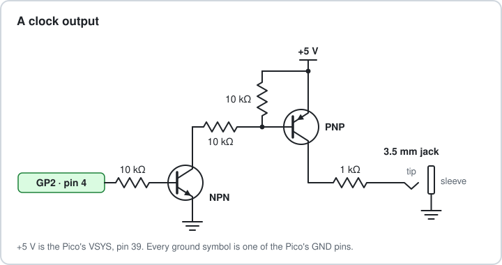
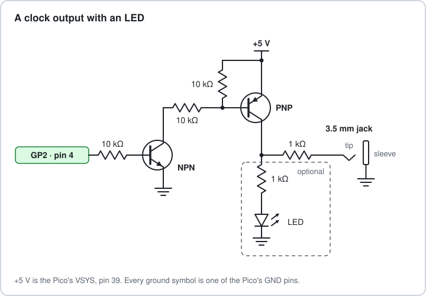
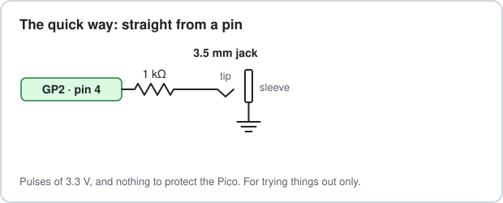
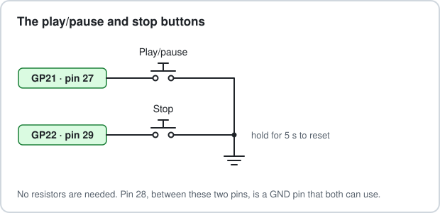
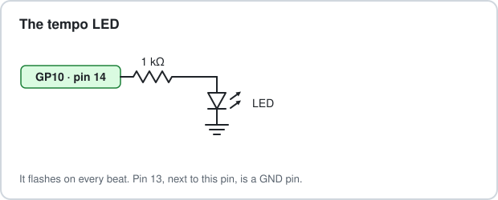
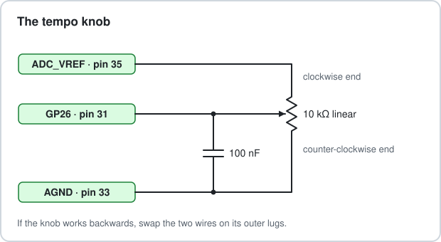
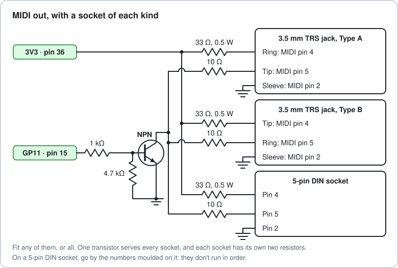
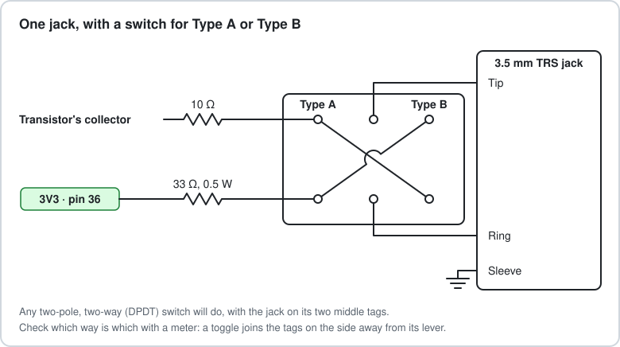
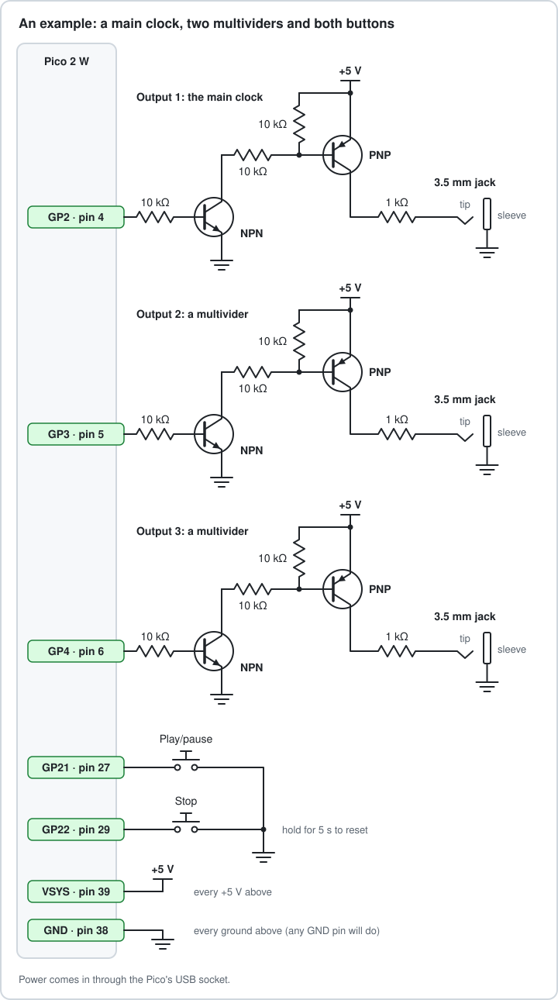

# SynthSync

**A microsecond-accurate DIY master clock for modular synths, with up to eight trigger outputs, each at its own multiple or division of the clock.** You set it from your phone or computer, over its built-in WiFi.

SynthSync is a clock you build yourself, on a breadboard, from a handful of super-cheap, common parts. It keeps a Eurorack or other modular system, drum machines, sequencers and semi-modulars in time with each other. The software is free: you pay only for the parts.

- **Accurate.** Every pulse leaves within a millionth of a second of its ideal time, placed by hardware inside the Pico's chip. The outputs never drift apart, however long it runs. [How accurate is it?](#how-accurate-is-it) has the measurements.
- **Up to eight outputs, locked together.** Four out of the box. They all count from the same start, so pulses that should land together do.
- **A multivider on outputs 2 to 8.** Output 1 is the main clock, and each of the others multiplies or divides it, from ÷128 to ×24: triplets, dotted notes, and ratios such as ×0.75 or ×1.25 for polyrhythms.
- **Suits the gear you have.** The main clock sends from 1 to 48 pulses a beat, and any output can be set for an instrument that wants another rate. [Matching your other gear](#matching-your-other-gear) has the settings for a DFAM, a Volca and gear that wants 24 pulses a beat.
- **Set from any phone, tablet or computer.** It makes its own WiFi network, or joins your home or studio WiFi, where any web browser on that network can reach it. There's no app to install, no account and no internet needed.
- **More than a clock.** Any output can send a gate that stays high while the clock runs, or a single pulse when it starts or stops, for a sequencer's reset input.
- **Hands-on.** Play/pause and stop buttons, a tempo LED that flashes on the beat, and an LED on each output, if you fit them.
- **Starts by itself,** pulsing within a second of power, with the settings you last used.

**You don't need to write any code.** If you can patch a modular system and follow a simple circuit diagram, you can be up and running within an hour.


*The page SynthSync serves to your phone's web browser. The clock itself is the hardware you build.*

> **This README is a draft.** SynthSync is still being tested. Notes marked **To come** are waiting on a measurement, a decision or a piece of work.

## Contents

- [What it does](#what-it-does)
- [What you need](#what-you-need)
- [From parts to pulses](#from-parts-to-pulses)
- [Step 1: put MicroPython on the Pico](#step-1-put-micropython-on-the-pico)
- [Step 2: copy SynthSync onto the Pico](#step-2-copy-synthsync-onto-the-pico)
- [Step 3: try it from your phone](#step-3-try-it-from-your-phone)
- [Step 4: wire it up](#step-4-wire-it-up)
	- [Finding your way around the pins](#finding-your-way-around-the-pins)
	- [A clock output](#a-clock-output)
	- [A clock output with an LED](#a-clock-output-with-an-led)
	- [Why not straight from the pin?](#why-not-straight-from-the-pin)
	- [The play/pause and stop buttons](#the-playpause-and-stop-buttons)
	- [The tempo LED](#the-tempo-led)
	- [The tempo knob](#the-tempo-knob)
	- [MIDI out](#midi-out)
	- [Power](#power)
	- [Parts list](#parts-list)
	- [Choosing the transistors](#choosing-the-transistors)
	- [Choosing LEDs](#choosing-leds)
	- [A complete example](#a-complete-example)
- [Using SynthSync](#using-synthsync)
- [Matching your other gear](#matching-your-other-gear)
- [WiFi](#wifi)
- [More or fewer outputs](#more-or-fewer-outputs)
- [Choosing the tempo range](#choosing-the-tempo-range)
- [How accurate is it?](#how-accurate-is-it)
- [If something isn't working](#if-something-isnt-working)
- [What it doesn't do](#what-it-doesnt-do)
- [For developers](#for-developers)
- [Licence and thanks](#licence-and-thanks)

## What it does

- **Sets the tempo for your system,** from 20 to 300 BPM, in steps as fine as 0.01 BPM. You can [choose another range](#choosing-the-tempo-range), anywhere from 1 to 1000 BPM.
- **Has up to eight clock outputs,** four of them out of the box. Each is a 3.5 mm jack that pulses at about 5 V. For now, read [More or fewer outputs](#more-or-fewer-outputs) before using more than four.
- **Output 1 is the main clock.** Out of the box it sends four pulses a beat, one for each 16th note, which is what most step sequencers want. You can change that to suit your gear: [Matching your other gear](#matching-your-other-gear) says how.
- **Every other output is a multivider:** a clock multiplier and divider in one, named the way an attenuverter is. Each has its own ratio of the main clock: ×2 is twice as fast, and ÷4 a quarter as fast. The slowest is ÷128. The fastest is ×24 at four pulses a beat, because no output goes faster than 96 pulses a beat.
- **Keeps every output locked to the others.** They all count from the same start, so outputs that should land together do. Change a ratio while the clock runs and that output moves straight onto its new grid, without a restart.
- **Snaps ratios to musical values** when you want it to: halves and doubles, triplets, dotted values, and the sync rates other gear expects. They are the same notes whatever the main clock sends.
- **Gives each output a few more choices:**
	- an on/off switch, which brings the output back in step when you turn it on again;
	- a pulse length, from 1 to 100 ms, or half the gap between pulses;
	- a role: a multivider, a single pulse when the clock starts, a single pulse when it stops, or a gate that stays high while the clock runs.
- **Plays, pauses and stops** from the page, or from two push buttons if you fit them.
- **Starts by itself.** Give it power and it is pulsing within a second, with the settings you last used.
- **Runs its own WiFi network,** or joins yours.
- **Keeps time in hardware.** The pulses are placed by a part of the Pico's chip made for exact timing, apart from the page and the WiFi. [How accurate is it?](#how-accurate-is-it) has the measurements.

## What you need

**To build it:**

- **A Raspberry Pi Pico 2 W.** The "2" and the "W" both matter: SynthSync is built and tested on this board only. One sold with header pins already soldered, often called a Pico 2 WH, saves you soldering forty pins.
- **A micro-USB cable** that carries data, and somewhere to plug it in for 5 V power: a phone charger, a power bank or a computer.
- **For each clock output:** two transistors, four resistors and a 3.5 mm jack socket.
- **A breadboard and some jumper wires** to build it on first. Stripboard and a soldering iron make it permanent later.
- **Optional:** two push buttons, and some LEDs with a resistor each.

The [parts list](#parts-list) has the detail, and says what is required and what is optional.

**To set it up and use it:**

- **A computer, once,** to copy the software onto the Pico. Windows, macOS and Linux all work.
- **A phone,** or anything else with WiFi and a web browser.

**What you need to know:**

- How to place parts on a breadboard from a circuit diagram. The diagrams here use the standard symbols, and each one says which of the Pico's pins it connects to.
- Nothing about programming.

## From parts to pulses

The whole job, in order. You can stop after step 3 and already have a working clock on your phone's screen, before you have wired a single part.

1. **[Put MicroPython on the Pico.](#step-1-put-micropython-on-the-pico)** MicroPython is the free system SynthSync runs on. You drag one file onto the Pico.
2. **[Copy SynthSync onto the Pico.](#step-2-copy-synthsync-onto-the-pico)** You download a folder and copy it across with a free app.
3. **[Try it from your phone.](#step-3-try-it-from-your-phone)** The Pico's own light flashes on the beat, and the page sets the tempo.
4. **[Wire it up.](#step-4-wire-it-up)** One clock output is enough to start. Add more outputs, LEDs and the buttons as you like.

## Step 1: put MicroPython on the Pico

1. **Download MicroPython for the Pico 2 W** from [micropython.org/download/RPI_PICO2_W](https://micropython.org/download/RPI_PICO2_W/). Take **version 1.29.0**, the file named `RPI_PICO2_W-20260824-v1.29.0.uf2`, even if a newer one is listed. SynthSync is built and tested for that version.
2. **Hold down the Pico's only button** (it is marked BOOTSEL), and plug the Pico into your computer while you hold it. Then let go.
3. **A drive named `RP2350` appears,** as a USB stick would.
4. **Drag the file you downloaded onto that drive.** The drive disappears by itself a few seconds later. That is all: MicroPython is on.

Raspberry Pi's own guide to this, with pictures, is [here](https://www.raspberrypi.com/documentation/microcontrollers/micropython.html).

## Step 2: copy SynthSync onto the Pico

> **To come:** Thonny's exact menu names still have to be checked against a real install.

[Thonny](https://thonny.org/) is a free app that can show the files on a Pico beside the files on your computer, and copy between the two.

1. **Download the SynthSync zip file** from this project's [Releases](https://github.com/simonholliday/SynthSync/releases) page, and unzip it.
2. **Install Thonny** from [thonny.org](https://thonny.org/), and open it with the Pico plugged in.
3. **Tell Thonny it is talking to a Pico:** in the menu **Run → Select interpreter**, choose MicroPython for the Raspberry Pi Pico.
4. **Show the files:** **View → Files**. Your computer's files are in the top half, and the Pico's are in the bottom half, which is empty for now.
5. **In the top half, open the folder you unzipped.** Select everything inside it, right-click, and choose **Upload to /**.
6. **Unplug the Pico and plug it in again.** Within a second, the small light on the Pico starts to flash on the beat. SynthSync is running.

**To update SynthSync later,** download the new zip and repeat steps 5 and 6, letting Thonny replace the files already on the Pico. Your settings, your WiFi and your `config.txt` stay as they are, because the zip holds none of them.

**If SynthSync doesn't start,** press the red Stop button in Thonny, delete `main.py` from the Pico's side, and copy the files across again.

If you are at home on a command line, [For developers](#for-developers) has another way.

## Step 3: try it from your phone

Nothing needs to be wired for this. The Pico only needs power from its USB socket.

1. **Look at the Pico's own light.** It flashes once a beat, at 120 BPM to begin with. The clock is already running.
2. **On your phone, look at the WiFi networks.** One is called `SynthSync` followed by six letters and numbers, such as `SynthSync AB78D9`. Join it. The password is `synthsync`.
3. **The page opens by itself,** the way a hotel's sign-in page does.
4. **Turn the tempo knob.** The Pico's light speeds up and slows down with it. Tap the stop button, and the light stops.

**If the page doesn't open by itself:** turn your phone's mobile data off, open a web browser and go to `http://192.168.4.1`. With mobile data on, a phone tries to reach that address over the mobile network, where it doesn't exist.

Once this works, the software side is done. The rest is wiring.

## Step 4: wire it up

### Finding your way around the pins

The Pico has forty pins, twenty down each long side. With the USB socket at the top and the button facing you, pin 1 is at the top left. The numbers run down the left side to pin 20, then up the right side from pin 21 to pin 40 at the top right.

Most pins also have a name, such as **GP2**. "GP" marks a general-purpose pin: one that SynthSync can switch between 0 V and 3.3 V, to make a pulse, or read, to see whether a button is pressed. A few pins are for power: **GND** is ground, and **VSYS** carries the 5 V that came in through the USB socket.

Every diagram below gives both, as in "GP2 · pin 4". Raspberry Pi's own pinout drawing shows them all: [Pico 2 W pinout (PDF)](https://datasheets.raspberrypi.com/picow/pico-2-w-pinout.pdf), with more about the board [here](https://www.raspberrypi.com/documentation/microcontrollers/pico-series.html).

| What | Name | Pin |
| --- | --- | --- |
| Output 1, the main clock | GP2 | 4 |
| Output 2 | GP3 | 5 |
| Output 3 | GP4 | 6 |
| Output 4 | GP5 | 7 |
| Outputs 5 to 8, if you add them | GP6 to GP9 | 9 to 12 |
| Tempo LED | GP10 | 14 |
| Play/pause button | GP21 | 27 |
| Stop button | GP22 | 29 |
| Tempo knob | GP26, with AGND and ADC_VREF | 31, with 33 and 35 |
| 5 V for the outputs | VSYS | 39 |
| Ground | GND | 3, 8, 13, 18, 23, 28 or 38 |

Leave every other pin unconnected.

### A clock output

**You need at least one of these.** Output 1 is the main clock, and it is the place to start.

<picture>
<source media="(prefers-color-scheme: dark)" srcset="docs/images/output-dark.svg">

</picture>

A Pico pin gives 3.3 V and shouldn't be patched straight into a modular system. These two transistors do two jobs: they turn the pin's 3.3 V into a 5 V pulse, and they stand between the Pico and whatever gets plugged into the jack.

**How it works:** when the pin goes high, it switches the first transistor on. That switches the second one on, which connects the jack to 5 V. When the pin goes low, both switch off and the jack sits at 0 V. So the jack does just what the pin does, at a higher voltage. It stays at 0 V while the clock is stopped, and while SynthSync is starting up.

**For each output you need:**

- one NPN transistor and one PNP transistor, of [almost any small kind](#choosing-the-transistors);
- three 10 kΩ resistors and one 1 kΩ resistor;
- one 3.5 mm mono jack socket.

**Check which leg is which.** A transistor has three legs: base, collector and emitter. Their order differs from one type of transistor to another, so look up yours before you plug it in. In the diagram, the base is the leg that meets the flat bar, and the emitter is the one with the arrow.

**Every other output is the same circuit** on the next pin along: output 2 on GP3, output 3 on GP4, and so on. They all share the same 5 V and the same ground.

> **To come:** the transistors we recommend, once our own build has been tested with real modules. Until then, [Choosing the transistors](#choosing-the-transistors) lists common ones that should do. The voltage at the jack is expected to be about 4.7 V on USB power, and that still has to be measured.

### A clock output with an LED

**Optional, for any output.** An output LED, with one more resistor, shows each pulse as it leaves the jack.

<picture>
<source media="(prefers-color-scheme: dark)" srcset="docs/images/output-led-dark.svg">

</picture>

An output LED shows the real pulse, so with the usual 10 ms pulse it is a quick blink. For a light that is easy to read as the beat, fit [the tempo LED](#the-tempo-led) as well. The LED's longer leg goes towards the resistor, and its shorter leg to ground. Any colour will do, and [Choosing LEDs](#choosing-leds) says more.

### Why not straight from the pin?

It is tempting to leave the transistors out and wire a pin to a jack. There are two reasons not to:

- **3.3 V isn't always enough.** Many clock inputs trigger well below that, and 3.3 V works for them. Others want about 3 V or more before they count a pulse, which leaves 3.3 V with nothing to spare. 5 V is a common level for a clock or a gate.
- **Nothing protects the Pico.** In a modular system, any jack might get an output patched into it by mistake. Outputs can sit at 10 V or more, above or below ground. A Pico pin is made for 0 to 3.3 V, and a wrong patch can destroy the pin or the whole board.

**That said, it often works, and it is a quick way to see your modules follow the clock** before the transistors arrive:

<picture>
<source media="(prefers-color-scheme: dark)" srcset="docs/images/direct-dark.svg">

</picture>

The resistor improves the Pico's chances if something is patched wrongly. It doesn't make it safe. The risk is to the Pico, which is cheap to replace, and not to your modules. If a module ignores the pulses, 3.3 V is too low for it, and the proper output above will put that right.

### The play/pause and stop buttons

**Optional, and the stop button is recommended.** Everything the buttons do can also be done from the page. But holding the stop button is the way back if you ever lose track of SynthSync on your WiFi.

<picture>
<source media="(prefers-color-scheme: dark)" srcset="docs/images/buttons-dark.svg">

</picture>

Any push button that connects while it is pressed will do. Each one goes between its pin and ground, with nothing else: the Pico holds the pin at 3.3 V by itself, and pressing the button pulls it to ground.

- **Play/pause** starts the clock from the top when it is stopped, pauses it when it is running, and carries on from the same place when it is paused.
- **Stop** stops the clock at once and takes it back to the top.
- **Stop, held down,** wipes every setting. After two seconds, the tempo LED and the Pico's own light flash fast as a warning. After five seconds, everything goes back to how a new SynthSync has it, including the WiFi. Let go before then and nothing is wiped.

A press takes effect as the button goes down, not when you let go.

### The tempo LED

**Optional, and the most useful LED to fit.** One LED that flashes on every beat, so you can see the tempo at a glance.

<picture>
<source media="(prefers-color-scheme: dark)" srcset="docs/images/tempo-led-dark.svg">

</picture>

It shows the BPM: one flash a beat, whatever the outputs are set to. That makes it different from an [output LED](#a-clock-output-with-an-led):

- **An output LED shows exactly what leaves its jack.** Output 1 sends four pulses a beat out of the box, so its LED blinks four times for each flash of the tempo LED. With the usual 10 ms pulse, each blink is short enough to miss.
- **The tempo LED stays lit for a quarter of each beat,** up to a tenth of a second. So it reads as a steady beat. Each flash begins at the very moment the beat's pulses leave the jacks.

It has one more job. While the stop button is held for a reset, it flashes fast as the warning. An output LED can't do that, because it only ever shows what its jack is sending.

It goes dark while the clock is paused or stopped. It keeps flashing when output 1 is switched off, because it follows the beat, not an output.

Unlike the output LEDs, it needs no transistors: just a resistor from the pin. The resistor can be anything from 330 Ω to 1 kΩ, and a smaller one makes the LED brighter. For a blue, white or bright green LED, use 330 Ω: [Choosing LEDs](#choosing-leds) says why. The light on the Pico itself flashes on the beat too, but it is hidden once the board is in a case.

### The tempo knob

**Optional.** A knob on the panel sets the tempo by hand, so with the two buttons you can run the clock with no phone at all.

<picture>
<source media="(prefers-color-scheme: dark)" srcset="docs/images/tempo-knob-dark.svg">

</picture>

Use a 10 kΩ linear potentiometer, often marked B10K. Fit the 100 nF capacitor close to the Pico. There is nothing to set: SynthSync checks for the knob when it starts, and leaves the pin alone if there isn't one. If you add a knob later, restart the Pico.

- **Straight up is 120 BPM.** A quarter of the way round is 80 and three quarters is 180, with 20 and 300 at the ends. If you [choose another range](#choosing-the-tempo-range), the knob covers that instead, in the same proportions.
- **The last control you touched has the tempo.** Turn the knob and the page follows it. Change the tempo on the page and the knob lets go.
- **The tempo never jumps.** After a change from the page, the knob does nothing until you have moved it to the current tempo. From there it takes over.
- **At power-up,** the saved tempo plays if the knob is where you left it. If it was turned while the Pico was off, the knob sets the tempo.

### MIDI out

**Optional.** Sockets that send MIDI clock, so that drum machines, sequencers and effects with a MIDI input can follow SynthSync.

MIDI comes on three kinds of socket: 3.5 mm TRS jacks wired **Type A** or **Type B**, and the older 5-pin DIN. Check which your gear has. Type A is the MIDI standard, and some gear from Arturia, Novation and Erica Synths is Type B. The wrong type shouldn't harm anything, but nothing will follow. There are two ways to wire it, and both start with one transistor.

**A socket for each type you want.** Fit any of them, or all three, and they all work at once. Each socket needs its own 33 Ω and 10 Ω resistors.

<picture>
<source media="(prefers-color-scheme: dark)" srcset="docs/images/midi-dark.svg">

</picture>

| Socket | 33 Ω, from 3.3 V | 10 Ω, from the transistor | Ground |
| --- | --- | --- | --- |
| 3.5 mm TRS jack, Type A | Ring | Tip | Sleeve |
| 3.5 mm TRS jack, Type B | Tip | Ring | Sleeve |
| 5-pin DIN socket | Pin 4 | Pin 5 | Pin 2 |

**Or one jack with a switch.** A two-pole, two-way switch swaps the tip and ring, so one jack serves both types. Build the transistor as above, and use one 33 Ω and one 10 Ω resistor.

<picture>
<source media="(prefers-color-scheme: dark)" srcset="docs/images/midi-switch-dark.svg">

</picture>

It sends 24 clocks a beat, and Start, Continue and Stop as you press play, pause and stop. Each clock finishes arriving as the matching pulse leaves the outputs. No Song Position or notes are sent.

- **Use half-watt 33 Ω resistors.** A patch cable plugged in by mistake shorts that socket's resistor across the supply, and half a watt takes that. The transistor keeps whatever that cable carries away from the Pico.
- **Don't leave patch cables in MIDI sockets.** Each one draws about 100 mA from the Pico's 3.3 V pin, which can give about 300 mA.

**To choose what it sends,** open **Settings** and look under **MIDI clock**:

| Choice | What it sends |
| --- | --- |
| **Always** | Clock all the time, so that other gear knows the tempo before you press play. This is how it starts. |
| **While playing** | Clock only while SynthSync is playing. Try this if something misbehaves with a clock running while stopped. |
| **Off** | Nothing. |

MIDI needs a millisecond between Start and the first clock, so with it on the outputs begin a little later: within 8 ms of pressing play, against about 2 ms with **Off**.

> **To come:** neither way of wiring it has yet been built and tried with real MIDI gear.

### Power

**SynthSync runs on 5 V through the Pico's USB socket.** A phone charger, a power bank or a computer's USB port all do.

The clock outputs take their 5 V from the Pico's VSYS pin, pin 39, as the diagrams show.

**Don't connect a Eurorack power supply to the Pico.** Its +12 V and −12 V rails will destroy it.

> **To come:** how to power SynthSync from a 9 V battery, and from a Eurorack case. Both need a few more parts to bring the voltage down to 5 V safely. Neither changes the circuits above.

### Parts list

| Part | Needed? | How many |
| --- | --- | --- |
| Raspberry Pi Pico 2 W, with header pins | Required | 1 |
| Micro-USB cable and 5 V USB power | Required | 1 |
| NPN transistor | Required | 1 for each output |
| PNP transistor | Required | 1 for each output |
| 10 kΩ resistor | Required | 3 for each output |
| 1 kΩ resistor | Required | 1 for each output |
| 3.5 mm mono jack socket | Required | 1 for each output |
| Push button, for stop | Recommended | 1 |
| Push button, for play/pause | Optional | 1 |
| Tempo LED, and a resistor of 330 Ω to 1 kΩ | Optional, and the most useful LED | 1 of each |
| Output LED, and a 1 kΩ resistor | Optional | 1 of each, for each output you want one on |
| For the [tempo knob](#the-tempo-knob): 10 kΩ linear potentiometer, 100 nF capacitor | Optional | 1 of each |
| For [MIDI out](#midi-out): NPN transistor, 1 kΩ and 4.7 kΩ resistors | Optional | 1 of each |
| For each MIDI socket: 3.5 mm stereo jack or 5-pin DIN socket, 33 Ω 0.5 W and 10 Ω resistors | Optional | 1 of each |
| For one MIDI jack that serves both types: two-pole, two-way (DPDT) switch | Optional | 1 |
| Breadboard and jumper wires | To build it on | |

Ordinary quarter-watt resistors are fine. Start with output 1, and add outputs in order: 2, then 3, and so on. The next two sections help you find the transistors and LEDs in a shop.

### Choosing the transistors

**Any small, general-purpose NPN and PNP transistors will do.** Each one carries only a few milliamps here, far below what even the smallest can take. Most come in a small black plastic body with one flat face and three legs, called TO-92. Some common ones to search for:

| NPN | PNP | Good to know |
| --- | --- | --- |
| 2N3904 | 2N3906 | |
| BC547 | BC557 | BC546, BC548, BC549 and BC550 are the same family, as are BC556, BC558, BC559 and BC560 |
| BC337 | BC327 | |
| 2N2222 or PN2222A | 2N2907 or PN2907A | |
| S8050 | S8550 | Common in low-cost assortment kits |
| 2SC1815 | 2SA1015 | Printed C1815 and A1015 on the body |
| BC107, BC108 or BC109 | BC177, BC178 or BC179 | Older, in a small metal can |

- **Each row is a pair often sold together, but the two needn't match.** They do separate jobs in an output, so any NPN works with any PNP.
- **A letter after a BC number, such as the B in BC547B, is a grade.** Any grade works.
- **A transistor assortment kit** usually has several of these pairs, and costs little.
- **Look up which leg is which on the ones you buy.** Search for the name and "pinout". A 2N3904 and a BC547, for example, have their legs in opposite orders.
- **Avoid Darlington transistors, such as the TIP120, and MOSFETs, such as the 2N7000.** Shops often list them beside these, but they're different kinds of part, and this circuit isn't drawn for them.

### Choosing LEDs

**Any colour works** with the resistors the diagrams show.

**Each colour takes a different voltage to light,** called its forward voltage, and written Vf in a shop's listing. It depends on what the LED is made of:

- **Red, orange and yellow** take about 2 V.
- **Blue, white and bright green** take about 3 V, as do pink and purple, which are usually blue LEDs inside.
- **Green comes in two kinds:** an older, yellowish green that takes about 2 V, and a brighter "true" green that takes about 3 V. The Vf in the listing tells you which you have.

**What that means here:**

- **An output LED** gets about 5 V, which is plenty for any colour. Use 1 kΩ, whatever the colour.
- **The tempo LED** gets the Pico's 3.3 V, which leaves a 3 V LED little to spare. Red, orange, yellow and yellowish green light well with anything from 330 Ω to 1 kΩ. Blue, white, bright green, pink and purple light too, but more dimly, so give them 330 Ω.

**And a few tips:**

- **Colours don't look equally bright,** even with the same resistor, and makes differ too. If one LED outshines the others, a larger resistor, such as 2.2 kΩ, dims it.
- **Always fit the resistor.** It's what keeps the current safe. Without it, an LED can burn out, and the tempo LED can harm the Pico's pin.
- **Use plain, single-colour LEDs,** 3 mm or 5 mm. Frosted ones, often listed as diffused, are easier to see from the side. LEDs that flash or change colour by themselves, or that are sold as addressable, have a chip inside and won't follow the beat.
- **To work out a resistor for yourself,** an online LED resistor calculator does it. Give it 5 V for an output LED, or 3.3 V for the tempo LED, and aim for a few milliamps. Keep the tempo LED's resistor to 330 Ω or more.

### A complete example

A whole SynthSync with three outputs and both buttons: the main clock on output 1, and a multivider on each of outputs 2 and 3.

<picture>
<source media="(prefers-color-scheme: dark)" srcset="docs/images/example-dark.svg">

</picture>

**It takes:** 3 NPN transistors, 3 PNP transistors, nine 10 kΩ resistors, three 1 kΩ resistors, 3 jack sockets and 2 push buttons, besides the Pico and its USB power.

SynthSync runs four outputs unless you tell it otherwise, so the page will show a fourth row with nothing wired to it. That does no harm. [More or fewer outputs](#more-or-fewer-outputs) says how to tidy it away.

## Using SynthSync

**The tempo** is at the top of the page. Turn the knob, or tap the number and type one.

**The strip above it** flashes on every beat while the clock is playing, so you can see the tempo at a glance. The page keeps count of the beat itself, so over WiFi the flash can sit slightly off the outputs.

**Tap tempo** is the bar under play and stop. It starts locked, so a stray touch can't change the tempo:

1. Touch **Tap tempo** to open the pad.
2. Tap the pad in time. The tempo changes from your fourth tap, and follows the average of your last eight, to the nearest whole BPM.
3. Stop tapping. After ten seconds it locks itself, or you can touch the padlock.

A pause of more than about three seconds starts the count again. The outputs keep their places as the tempo changes.

**Play/pause and stop** are under it, and work as a media player's do:

- The left button shows what a tap will do next: ❚❚ to pause while the clock is running, and ▶ to play.
- The right button, ■, stops the clock and takes it back to the top.
- One of the two is always lit. The left one is lit while the clock is playing or paused, and the right one while it is stopped.
- ▶ after a pause carries on from the same place. ▶ after a stop starts again from the top, with every output pulsing together.

**Each output has a row,** with:

- **a light** that blinks where its pulses fall;
- **a switch** to turn it on and off. An output that is off stays silent and keeps its place, so it comes back in step. You can change its settings while it is off, and bring the change in with the switch;
- **a knob and a number for its ratio** of the main clock. ×2 is twice as fast as output 1, and ÷4 a quarter as fast, which at the usual four pulses a beat is one pulse a beat. You can type a ratio too, as a number such as `1.5` or a fraction such as `4/3`;
- **Snap.** While it is lit, the knob steps through musical values only. Turn it off and the knob moves freely. Turn it on again and the ratio moves to the nearest musical value;
- **an arrow** that opens two more settings:
	- **Role:** a multivider; a start pulse, which is one pulse when the clock starts from the top; a stop pulse, which is one pulse when it stops; or run, which stays high while the clock is running. Start and stop pulses suit a sequencer's reset input.
	- **Pulse:** how long each pulse lasts, from 1 to 100 ms, or half the gap between pulses. It starts at 10 ms. Some modules, and DIN sync, want the half.

Output 1 is always the main clock, so its row has no ratio to set. It says how many pulses a beat it sends, such as "4 PPQN".

**Two phones can be open at once,** and each follows what the other does.

**Settings,** at the top of the page, has how many pulses a beat the main clock sends, how the page looks, the WiFi, a button that puts every setting back as new, and a count of timing faults, which should always read zero.

**The page is dark** unless you choose another look under **Look**: light, one that follows your device's own setting, or one of eight others. Each device keeps its own choice, so a phone on the stage can stay dark while a tablet in daylight is light.

**The lights on the hardware:**

- The tempo LED, if you fit one, and the Pico's own light are on for the first quarter of every beat while the clock runs.
- Each output LED, if you fit them, shows its output's pulses as they leave the jack.
- The tempo LED and the Pico's own light flash fast while the stop button is held down for a reset.

## Matching your other gear

**Gear with a MIDI input** can follow SynthSync through its [MIDI socket](#midi-out). It gets 24 clocks a beat, whatever the outputs are set to, with Start, Continue and Stop to match the play and stop buttons.

**Clocks don't agree on how many pulses make a beat.** The usual measure is PPQN, pulses per quarter note. A step sequencer such as a Moog DFAM takes one step for each pulse it gets. Fed one pulse a beat, it plays quarter notes. Fed four, it plays 16th notes, which is what most people expect. So if a module plays at a quarter of the speed you expect, or four times it, this is almost always why.

**SynthSync's main clock sends four pulses a beat** unless you change it, so a sequencer on output 1 plays 16th notes at the tempo on the page. The BPM always counts quarter-note beats, as on any other gear.

**To change it,** open **Settings** and choose under **Clock**: 1, 2, 4, 8, 12, 16, 24 or 48. Every other output is a ratio of the main clock, so they all change speed with it, just as the dividers after a master clock do when its rate changes. It is a setting to choose once, to suit most of your system.

**Gear that wants a different rate** gets it from its own output. At the usual four pulses a beat:

| For | Set the output to |
| --- | --- |
| A step sequencer that moves on each pulse, in 16th notes, such as a DFAM | ×1, or use output 1 |
| Quarter notes, one pulse a beat: clock dividers, and effects that sync to a clock | ÷4 |
| 8th notes, as Korg's Volca sync expects | ÷2 |
| 8th-note triplets | ×0.75 |
| 24 pulses a beat, as DIN sync and some modules' clock inputs expect | ×6 |
| 48 pulses a beat | ×12 |
| One pulse a bar of 4/4 | ÷16 |

With Snap lit, an output's knob stops on each of these. If most of your system wants 24 pulses a beat, say, set the main clock to 24 instead, and give the odd module out its own ratio.

## WiFi

**Out of the box, SynthSync is its own WiFi network.** It is called `SynthSync` and six characters taken from the board itself, so two SynthSyncs can be told apart. The password is `synthsync`, and Settings lets you change it. The page is at `http://192.168.4.1`. This is all you need, and it works anywhere, with no router.

**It can join your WiFi instead,** which keeps your phone on the internet while you use it:

1. In **Settings**, tap **Join a WiFi network…**, pick yours and type its password.
2. SynthSync disappears for up to 20 seconds while it tries your network. The clock keeps running.
3. It comes back on its own network, and the page shows the address it was given on yours, such as `http://192.168.1.50`. **Write that address down.**
4. Tap the button to switch now, or wait two minutes and it switches by itself.
5. Put your phone back on your own WiFi, and open that address.

`http://synthsync.local` also works on some phones and computers, and not on others. The address always works.

**If your WiFi goes away** for a minute, SynthSync brings its own network back. It rejoins yours by itself once it hears it again, unless a phone is using its own network at the time.

**If you can't find SynthSync on your WiFi:** look for "synthsync" in your router's list of devices. Failing that, hold the stop button for five seconds: the lights flash, every setting is wiped, and SynthSync's own network comes back. With no stop button fitted, a piece of wire held between pin 29 and pin 28, which are next to each other, does the same thing.

SynthSync's own network and your WiFi are never on at the same time.

## More or fewer outputs

SynthSync runs four outputs out of the box, on GP2 to GP5. If you wire fewer, the spare ones do no harm. To have the page show only the outputs you built, or to add up to eight, you change one line in `config.txt`, a small text file SynthSync makes on the Pico the first time it starts:

```
# How many clock outputs are wired, from 1 to 8.
outputs = 6
```

Open the file with Thonny, as in [step 2](#step-2-copy-synthsync-onto-the-pico), change the number, save it, and unplug the Pico and plug it in again. If SynthSync can't make sense of a line, it carries on with four outputs and says so on the Settings page. You can't break the clock by getting this file wrong.

Eight is the most there can be. Outputs 5 to 8 are on GP6 to GP9, pins 9 to 12.

**More than four outputs carry a risk, for now.** In every test with up to eight, no pulse came late. But with eight, SynthSync has much less to spare than with four:

- **SynthSync works out every pulse a moment before it plays it.** The busier the outputs, the less time that leaves it. With four, it has always had plenty in hand.
- **With all eight as fast as the page allows,** at 300 BPM with MIDI's clock going, it has sometimes come down to its very last moment to spare, most often while the page was in hard use. Every close call so far has been with all eight that busy.
- **If it ever ran out, a pulse would come late,** and every pulse after it by the same amount. The outputs would stay in step with each other, but SynthSync would be that much behind any other clock running by itself, and a MIDI message going out at that moment could be garbled.
- **The twelve-hour tests** in [How accurate is it?](#how-accurate-is-it) were all made with four outputs.

So for a gig or a recording, keep to four for now.

> **To come:** more to spare with eight outputs, so that they are as safe as four, and the twelve-hour tests repeated with eight.

## Choosing the tempo range

The tempo runs from 20 to 300 BPM unless you change it. You might want a narrow range, to set a tempo very finely, or an extreme one to experiment with. Add these lines to `config.txt`, in the same way as above, with any numbers from 1 to 1000:

```
min_bpm = 100
max_bpm = 110
```

The range applies everywhere: the page's knob, tap tempo, and the [tempo knob](#the-tempo-knob). The narrower it is, the finer the steps those knobs move in. A saved tempo outside the new range plays at the nearest end of it.

Going beyond 20 to 300 BPM narrows what the outputs can do, so that no output is asked for more than it can do at 20 or 300 BPM:

| Range reaches | What changes |
| --- | --- |
| Down to 1 BPM | An output can wait at most 6 beats between pulses, not 128 |
| Up to 1000 BPM | An output can send at most 28 pulses a beat, not 96, and the clock can't be set to 48 PPQN |

Ranges between those limits are in proportion. Anything that follows the clock may not cope with the extremes, so try them with care.

## How accurate is it?

There are two different questions here: how steady each pulse is, and how true the tempo stays over time. The figures below come from one Pico, timed for twelve hours.

**How steady is each pulse?** The pulses are placed by hardware inside the Pico's chip, counted from its crystal. No gap between one pulse and the next was more than a millionth of a second (1 µs) from what the tempo asks for. For scale, one sample of 48 kHz audio lasts about 21 µs, and one MIDI clock message takes 320 µs to send.

At 30, 60, 120 and 300 BPM, every gap came out identical. At 174 BPM the exact gap isn't a whole number of microseconds, so it alternates between 86,206 and 86,207 µs, which keeps the average exact. These small differences never add up, so the outputs don't drift against each other however long the clock runs.

**Does the tempo stay true over time?** Over the twelve hours, the Pico stayed within about 3 ms of network time, either way, and gained about 0.7 ms overall. In every hour, 120 BPM was still 120.000 BPM to three decimal places. Network time can only be read to about a millisecond over an ordinary internet connection, so part of that 3 ms may be the measurement itself.

That is one Pico's crystal on one night, and yours may stray further: the crystal's specification allows about a tenth of a second an hour. It only matters against another clock that is running free. Anything clocked from SynthSync's outputs follows it exactly.

**How we measured it.** Output 1 played 30, 60, 120, 174 and 300 BPM in turn, half an hour of each, at 4 pulses a beat, with the other outputs playing too. The Pico timed all of about 374,000 pulses at its own pin, to within 13 billionths of a second, and none was missing or out of place.

A separate twelve-hour test kept the page in constant use and saved the settings about twice a minute. All 407,443 pulses, at ten tempos from 60 to 300 BPM, were just as exact, with no late pulses and no timing faults.

All of these figures are for four outputs. With more, see [More or fewer outputs](#more-or-fewer-outputs).

**What this can't show.** The Pico times its pulses with the same crystal that makes them. So these figures show that each pulse leaves exactly when the chip means it to, but not any wobble in the crystal itself, or anything that happens after the pin, such as in the output transistor. That takes an outside instrument such as an oscilloscope, which is why we say "within 1 µs" and not "no jitter at all".

### Measuring your own board

You can find out how true your own SynthSync's tempo is, with nothing but the Pico on its USB cable and a computer on the internet. Leave it running overnight: the longer it runs, the closer the answer.

1. **Unplug anything patched to SynthSync's outputs or MIDI out.** For the whole run, output 1 plays 30, 60, 120, 174 and 300 BPM in turn, and the other outputs and MIDI clock play along.
2. **Install Python** (3.10 or newer) on the computer, and then mpremote, which talks to the Pico over USB: `python -m pip install mpremote`
3. **In a copy of SynthSync's source code,** from its GitHub page rather than the ready-made folder for the Pico, **run** `python -m tools.accuracy`

SynthSync stops while it measures, and starts again by itself at the end, with your settings as you left them. Every ten minutes it says how it is going. At the end it says whether every pulse was on time, how far the tempo strayed from network time in milliseconds, and what 120 BPM really came to. Add `--hours 1` for a quicker, rougher answer.

**How it works.** The Pico times every pulse of output 1 at its pin, to within 13 billionths of a second, which shows whether each one is where its tempo puts it. Every two seconds it tells the computer how long output 1 has been playing, by its own crystal. The computer notes when each report arrives. All the while, it asks time servers on the internet how far its own clock is out, and keeps only the answers that came back quickest. Over a night, the difference between the Pico's count and true time is the tempo's error.

## If something isn't working

| What you see | What to try |
| --- | --- |
| No `RP2350` drive appears in step 1 | Hold the button down before you plug the Pico in, and keep holding until it is connected. Try another USB cable: some carry power only. |
| The Pico's light doesn't flash after step 2 | Unplug it and plug it in again. If it still doesn't, repeat steps 1 and 2. |
| No `SynthSync` network on your phone | Give it ten seconds after plugging in. If SynthSync has joined your WiFi before, it joins that again and its own network stays off: see [WiFi](#wifi). |
| You join the network but no page opens | Turn mobile data off and go to `http://192.168.4.1`. |
| A module doesn't follow the clock | Try a longer pulse for that output, or the half pulse. Check the output with an LED, or with another module. |
| An output does nothing, or stays high | Check that each transistor is the right kind in the right place: the NPN is the one connected to the Pico's pin. Check which leg is which, that the 5 V comes from pin 39, and that the jack's sleeve reaches a GND pin. |
| SynthSync has gone missing on your WiFi | See [WiFi](#wifi). |
| The page stops answering for a while | The clock keeps time, and the buttons on the Pico still work. On a weak or busy WiFi signal, SynthSync can be held up sending to a phone, sometimes for tens of seconds, and it comes back by itself. Moving the phone or the Pico closer to each other, or to your router, helps. |

## What it doesn't do

- **It doesn't follow another clock.** SynthSync is a master clock only.
- **It doesn't send MIDI notes, or take MIDI in.** Its [MIDI socket](#midi-out) sends clock, Start, Continue and Stop.
- **It doesn't make 10 V gates.** The outputs are 5 V.
- **It hasn't been tested on any board but the Pico 2 W.**
- **The page can stop answering on a poor WiFi signal,** for a few seconds or occasionally longer. The clock and the buttons carry on regardless.

## For developers

SynthSync is written in MicroPython, with tests that run on an ordinary computer.

- **The page runs with no Pico:** `python -m synthsync.sim` serves it from a laptop, on the same code that keeps time on the board.
- **The tests:** `pip install -e '.[dev]'`, then `pytest` and `mypy`.
- **The version** is the git tag's, which the page's About shows. A Pico is given the version installed on the computer that copies SynthSync to it, so run `pip install -e '.[dev]'` again after tagging.
- **Copying it to a Pico from the command line:** `python -m tools.install`, which needs `mpy-cross` for the same version of MicroPython.
- **Making a release:** tag the commit, run `pip install -e '.[dev]'` again, and run `python -m tools.release FOLDER`. It makes the zip people download, and refuses anything but a clean, tagged commit. The same code always makes the same zip, so anyone can check a published one.
- **The wiring diagrams** in this README are drawn by `python -m tools.diagrams`, which needs nothing installed. Change a pin or a value there, never in the pictures.
- **The page's fonts** are cut down to the characters SynthSync shows, so the page stays small. After changing the page's words, run `python -m tools.fonts` to cut them again: the tests say when a character is missing.

> **To come:** a guide to the code, and to the rig that measures the timing on a real board.

## Licence and thanks

SynthSync is free and open source, under the [GNU Affero General Public License, version 3 or later](LICENSE). In short:

- **You can use it, build it, change it and share it,** and you can sell clocks that run it.
- **If you pass it on or sell it,** you must also give people its source code, with any changes you made, under the same licence.
- **If you change it and people use your version through its page,** that page must offer them the source code too.
- **It comes with no warranty.**

That is a summary, and the licence itself is what counts.

**Commercial licensing.** To use SynthSync in a closed-source product without these conditions, contact [Simon Holliday](https://simonholliday.com/) to discuss a commercial licence.

SynthSync runs on [MicroPython](https://micropython.org/), and its page is served by [Microdot](https://github.com/miguelgrinberg/microdot), both under the MIT licence. Microdot's licence goes onto the Pico with its code.

The page is set in [Inter](https://github.com/rsms/inter) and [Lexend](https://github.com/googlefonts/lexend), both under the [SIL Open Font Licence](https://openfontlicense.org/), whose text is beside each font in `fonts/`.
